# pabilan-aws-portfolio

Personal portfolio of **Kumarathass Pabilan**, a Computer Science undergraduate at the University of Colombo School of Computing (UCSC) focused on Machine Learning and Full-Stack Development. Built for the AWS Builder Center student portfolio challenge.

**Live site:** https://main.d2srve4h92m9bu.amplifyapp.com/

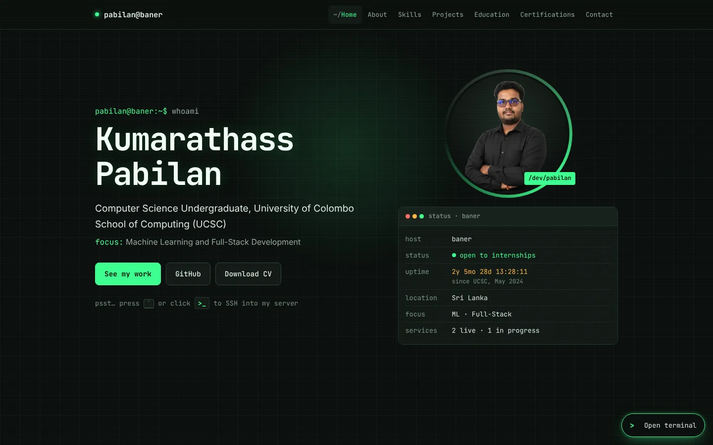

## The concept

I run a self-hosted home server called **`baner`**, so the whole site is designed as a live server dashboard for it:

| Section | Styled as |
|---|---|
| Hero | `whoami` typing out my name, plus a status panel with an uptime counter that started when I joined UCSC (May 2024) |
| About | `cat about.txt` in a terminal window |
| Skills | a system monitor (`top`): skill groups as CPU panels, each skill a process |
| Projects | `systemctl` services with live / in-progress / source status |
| Education | `git log --graph`, newest commit first |
| Certifications | `apt list --installed`, grouped by provider in collapsible lists |

## Creative feature: the `baner` terminal

Press <kbd>`</kbd>, click the floating **`>_` Open terminal** button, or use the hint in the hero to "SSH into" `baner`. The terminal opens with a short, skippable login and message of the day.

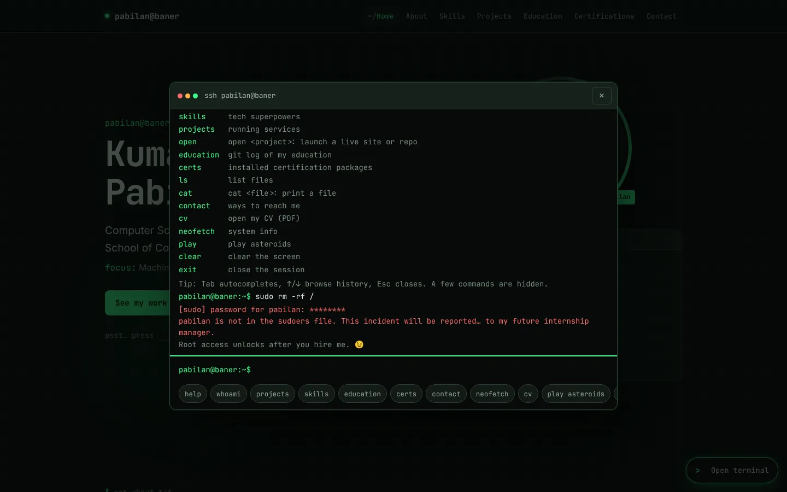

| Command | What it does |
|---|---|
| `help` | list commands |
| `whoami`, `about` | short and long bio |
| `skills` | skills printed as JSON |
| `projects`, `open <name>` | list projects; open a live site or repo in a new tab (`open stridetrack`) |
| `education`, `certs` | git-log education history; certificates with links |
| `ls`, `cd <section>` | list the page's sections as directories; `cd projects` closes the terminal and scrolls the page there |
| `cat <file>` | read `about.txt`, `skills.json`, `contact.txt`, `education.log` |
| `contact`, `cv` | contact links; open my CV |
| `clear`, `exit` | clear the screen; close the session |

Hidden extras: `sudo` (access politely denied), `neofetch` (a system-info card about me, with my photo as the logo) and `play asteroids`, a small canvas game that nods to the Boot.dev course where I built Asteroids in Python and Pygame.

| neofetch | play asteroids |
|---|---|
| 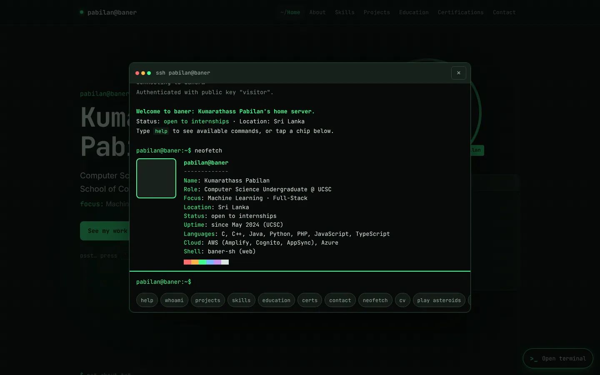 | 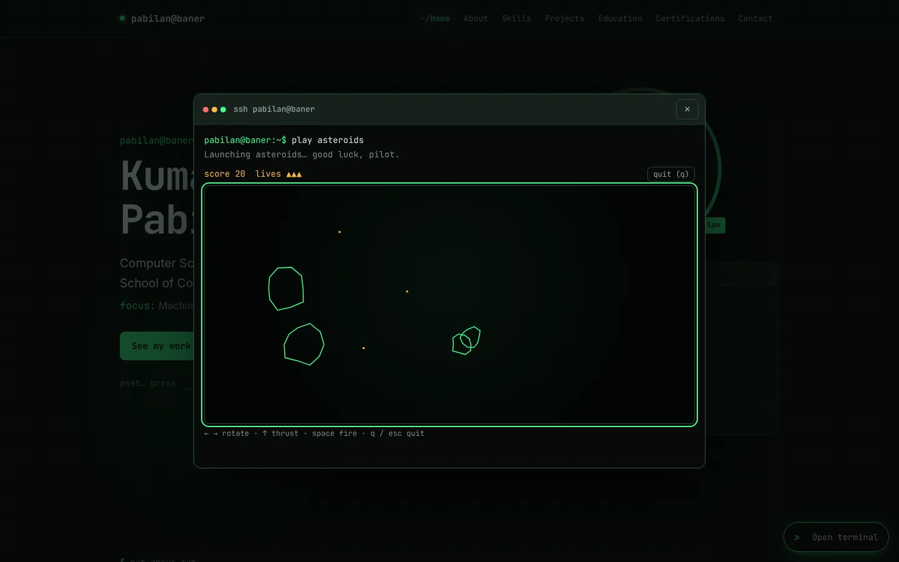 |

How it stays usable:

- **Shell features:** command history (↑/↓), Tab autocomplete for commands, sections, project names and file names, and a friendly "command not found" message.
- **Never in the way:** it's an overlay you can close with Esc, the × button or a click outside, and focus goes back to where you were. Everything it shows is also on the normal page, and `cd` turns it into another way to navigate the site.
- **Mobile:** opens full-screen with tappable command chips, and the game gets on-screen touch controls.
- **Accessible dialog:** focus stays inside while it's open, and with reduced motion turned on the boot sequence shows instantly.

## Arcade

The `~/arcade` section has six retro mini-games, all hand-written on a `<canvas>` with no game libraries: **Astro Shooter** (vertical space shooter with waves and a spread-shot power-up), **Snake**, **Block Drop** (falling blocks with line clears and levels), **Dino Dash** (endless runner), **Brick Breaker** and **Paddle Duel** (pong against the CPU). Pick a cartridge and it loads into the cabinet above the list.

- Keyboard controls only apply while the game screen has focus, so the page still scrolls normally. Clicking away pauses the game; `P` pauses and `R` restarts.
- Touch devices get an on-screen pad with the buttons each game needs, plus gestures on the game screen: swipe to steer in Snake, swipe and tap in Block Drop, tap or hold to jump in Dino Dash.
- High scores are saved per game in `localStorage`.
- From the terminal, `play snake`, `play blocks`, `play dino`, `play astro`, `play breakout` or `play pong` jumps to the arcade and starts that game.

## Screenshots

| Skills monitor | Projects as services |
|---|---|
| 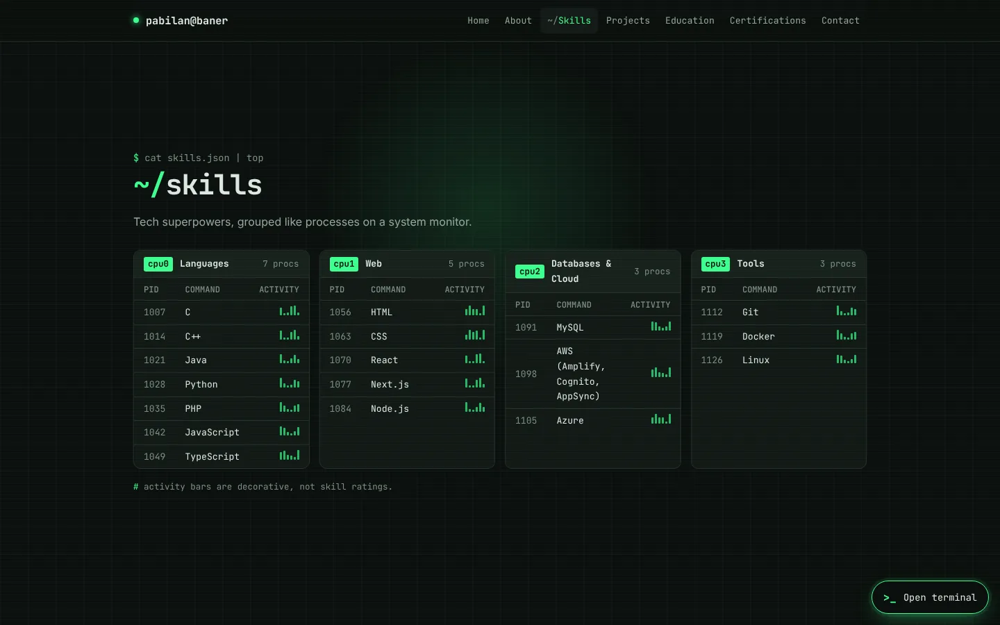 | 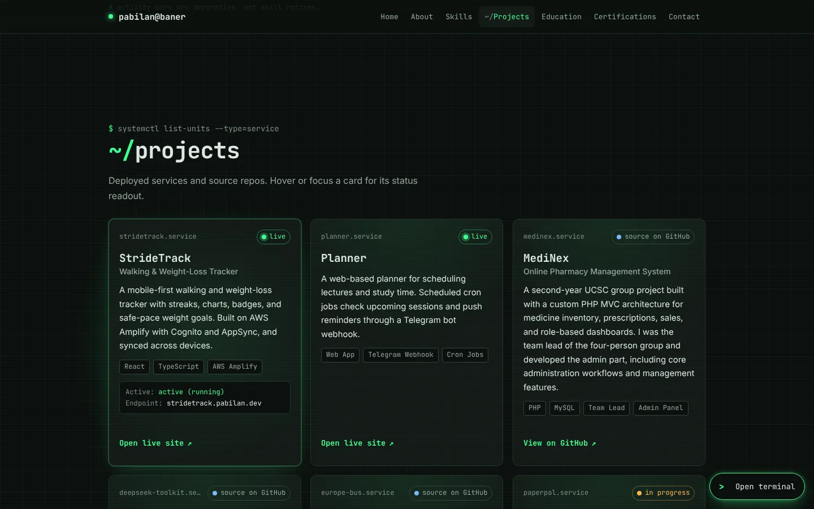 |

| Education as git log | Certifications as packages |
|---|---|
| 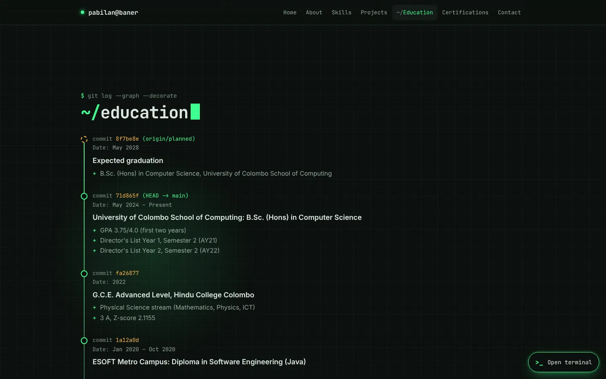 | 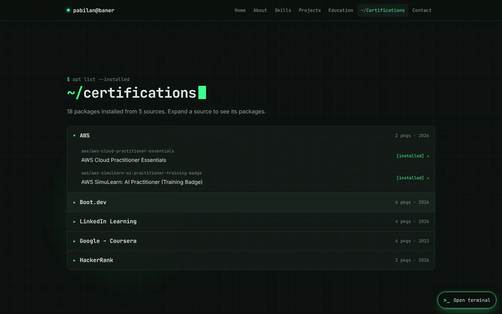 |

| Mobile | Mobile menu | Mobile terminal |
|---|---|---|
| 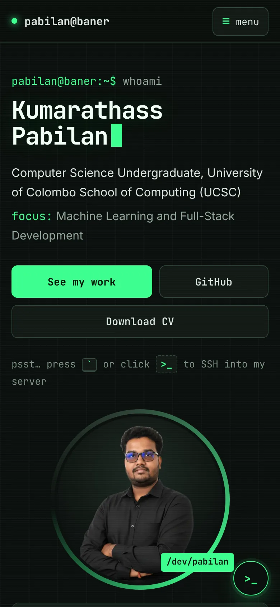 | 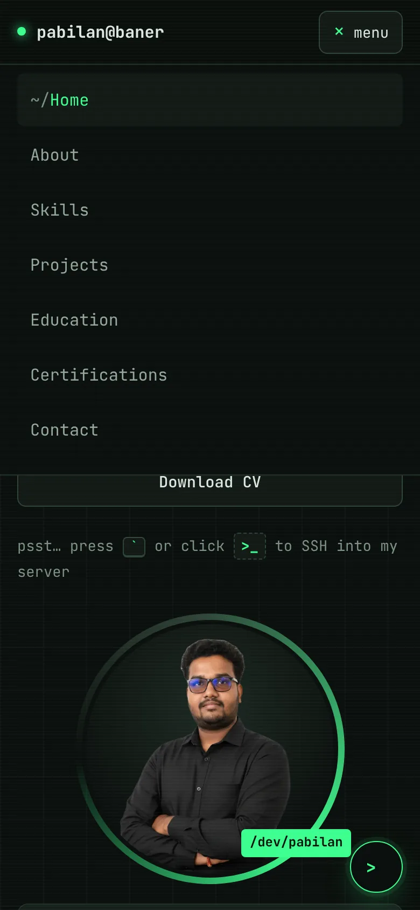 | 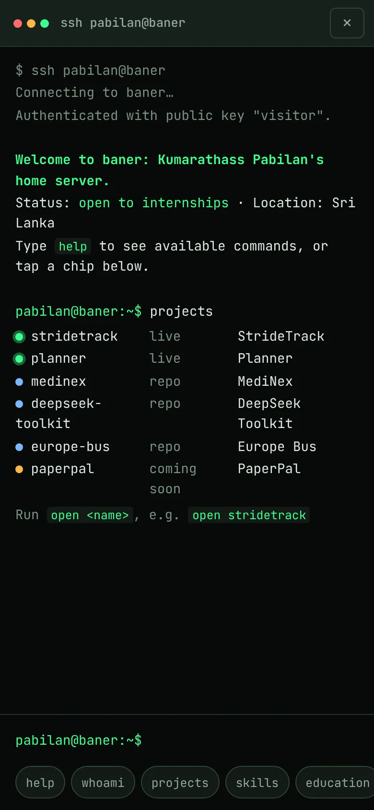 |

## AWS services used

**AWS Amplify Hosting** hosts the site:

- **CI/CD from GitHub:** Amplify is connected to the `main` branch of this repository. Every push starts a build that follows [`amplify.yml`](amplify.yml): install Node 22, then `npm ci`, then `npm run build`, and publish the `dist/` folder. A build and deploy takes about two minutes.
- **Global delivery:** the response headers show the files coming from Amazon S3 storage through the Amazon CloudFront CDN (`server: AmazonS3`, `x-cache: Hit from cloudfront`), so visitors get the site from an edge location near them.
- **HTTPS by default** on the `amplifyapp.com` domain, with no certificate setup needed.
- **Safe redeploys:** a failed build doesn't replace the live site, and earlier builds can be redeployed from the Amplify console.

I also use AWS beyond this portfolio. StrideTrack, one of the featured projects, runs on **AWS Amplify** with **Amazon Cognito** for sign-in and **AWS AppSync** for data synced across devices.

## Building it: challenges and how they were solved

1. **Build environment version.** Vite 8 needs Node.js 20.19 or newer, so `amplify.yml` installs and selects Node 22 before `npm ci` rather than relying on the build image's default.
2. **Layout overflow on phones.** At 375px the page scrolled sideways because a long line (the university name) was set not to wrap. Checking the site at 375, 768 and 1440px found it, and letting the text wrap fixed it.
3. **A transparent profile photo.** Flattening the image turned its transparent background black. The site keeps the transparent version (WebP with a PNG fallback), and a separate Open Graph image places the photo on the site's background colour, because link previews often show transparent images badly.
4. **Keyboard conflicts in the terminal.** Several keys had two jobs:
   - **Esc** both quits the game and closes the terminal, so the game handles it first.
   - **Tab** both autocompletes and moves focus, so it only autocompletes when something has been typed.
   - The <kbd>`</kbd> shortcut is ignored while the visitor is typing in a text field.
5. **Opening links from commands.** `window.open` with the `noopener` feature always returns `null`, so a blocked pop-up couldn't be detected. The terminal now opens the tab first and then clears `opener`, and it always prints a clickable link as a fallback.
6. **Accessibility beyond the Lighthouse score.** Lighthouse gave Accessibility 100, but it only checked what was visible on first load. A closer check of the whole page found:
   - 10 text elements below WCAG AA contrast;
   - 115 text elements smaller than 12px;
   - 18px-tall project links;
   - sections that stayed blank in full-page screenshots until scrolled to.

   All four were fixed. The scroll reveal is now motion only, so content is never hidden.

## Lessons learned

- **Configuring Amplify with `amplify.yml`.** This was my second time hosting a site on AWS Amplify, and this time I learned much more about how its build configuration works. The `amplify.yml` file in the repo defines every step:
  - `preBuild` installs Node 22 (Vite 8 needs 20.19 or newer) and runs `npm ci`;
  - `build` runs `npm run build`;
  - `artifacts` tells Amplify to publish the `dist/` folder.

  Because the configuration lives in the repo, it's versioned with the code and every push builds the same way. Pinning the Node version avoids "works locally, fails on Amplify" problems.
- **A memorable feature must never block the basics.** Every terminal command has a normal-page equivalent, and the terminal is one key press away from being closed.
- **Automated scores aren't the whole story.** Testing real interactions, real widths and every link found issues a perfect score missed.
- **Accessibility shapes the design from the start.** Reduced-motion support, focus management and contrast were much easier to get right as part of the theme than to bolt on afterwards.

## How it was built

I built this with [Claude Code](https://claude.com/claude-code) as an AI pair programmer. The concept, content and decisions are mine. Claude helped write and test the code and draft this README.

## Tech stack

- React 19 + TypeScript
- Vite (static build, no backend)
- Plain CSS (no UI libraries)
- AWS Amplify Hosting

## Run locally

Requires Node.js 20.19+ or 22.12+.

```bash
npm install
npm run dev       # http://localhost:5173
npm run build     # type-check + production build to dist/
npm run preview   # serve the production build
```

## Project structure

```
index.html                # meta, canonical + Open Graph tags
amplify.yml               # Amplify build spec (Node 22 → npm ci → npm run build → dist)
public/                   # profile.webp / profile.png, og-image.jpg, favicon
docs/screenshots/         # images used in this README
src/
  data.ts                 # ALL site content lives here
  App.tsx, main.tsx, styles.css
  components/             # Nav, Hero (+status panel), About, Skills, Projects,
                          # Education, Certifications, Contact, Footer, CursorGlow
  hooks/                  # reduced-motion, scroll reveal, uptime, active section
  terminal/               # Terminal overlay, commands, Asteroids mini-game
  arcade/                 # Arcade section: cabinet, shared engine, games/ (six mini-games)
```

To update content, edit `src/data.ts`. If the site moves to a new domain, update `canonical`, `og:url` and `og:image` in `index.html`.

---

© 2026 Kumarathass Pabilan · Hosted on AWS Amplify
